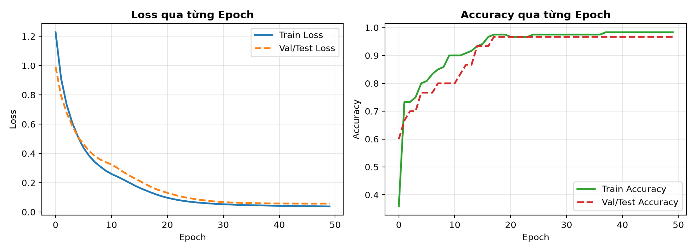
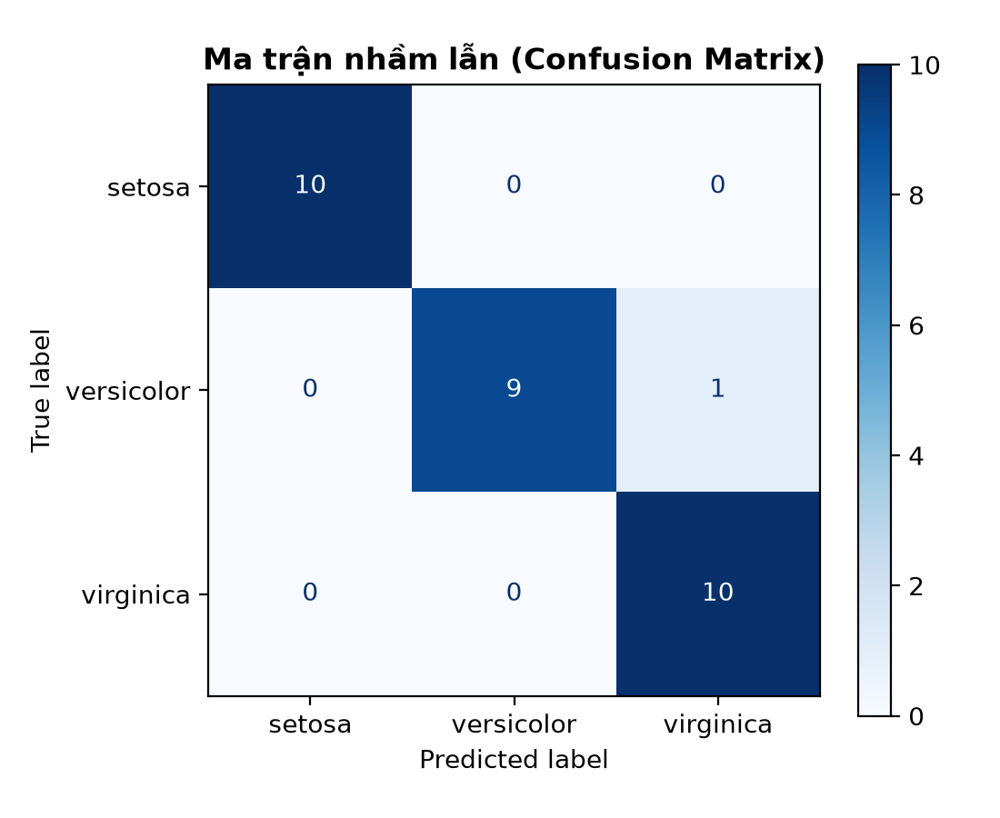

# Deep Learning với Keras cho bài toán phân loại hoa Iris

## Overview

Dự án xây dựng một mạng nơ-ron truyền thẳng (*Feedforward Neural Network / Multi-Layer Perceptron*) sử dụng thư viện **Keras / TensorFlow** để giải quyết bài toán phân loại đa lớp (*multi-class classification*) trên bộ dữ liệu hoa Iris kinh điển.

Tài liệu này ghi lại toàn bộ quy trình thực hiện chuẩn trong học máy (*Machine Learning*) và học sâu (*Deep Learning*): từ việc chuẩn bị dữ liệu, tránh rò rỉ dữ liệu (*data leakage*), thiết kế kiến trúc mạng, đến huấn luyện, trực quan hóa và đánh giá hiệu năng mô hình trên tập kiểm thử (*test set*).

---

## Cài đặt & Hướng dẫn chạy (Getting Started)

### 1. Yêu cầu môi trường
- Python >= 3.10
- Môi trường ảo (*virtual environment*)

### 2. Cài đặt các thư viện phụ thuộc
```bash
pip install -r requirements.txt
```

### 3. Thực thi dự án
Mở file [main.ipynb](file:///d:/workspace/python_for_all/iris_neural_network/main.ipynb) bằng VS Code / Jupyter Notebook hoặc Antigravity IDE và chạy tuần tự các cell (*Run All*).

---

## Quy trình triển khai

### 1. Load dataset hoa Iris

Bộ dữ liệu hoa Iris (*Iris flower dataset*) là bộ dữ liệu mẫu kinh điển trong học máy, bao gồm:

- **Quy mô:** 150 mẫu dữ liệu chia đều cho 3 loài hoa (mỗi loài 50 mẫu):
  - `0`: Iris Setosa
  - `1`: Iris Versicolor
  - `2`: Iris Virginica
- **4 đặc trưng đầu vào (*features*)** (đơn vị: cm):
  1. Chiều dài đài hoa (*sepal length*)
  2. Chiều rộng đài hoa (*sepal width*)
  3. Chiều dài cánh hoa (*petal length*)
  4. Chiều rộng cánh hoa (*petal width*)

### 2. Chia tập train/test trước khi tiền xử lý

- **Tỷ lệ phân chia:** Tách riêng 80% cho tập huấn luyện (*Train set* - 120 mẫu) và 20% cho tập kiểm thử (*Test set* - 30 mẫu).
- **Tránh rò rỉ dữ liệu (*Data Leakage*):** Việc chia tập train/test phải thực hiện **trước khi tiền xử lý** (như tính toán trung bình, độ lệch chuẩn để chuẩn hóa). Điều này đảm bảo mô hình không vô tình học trước bất kỳ thông tin nào từ tập kiểm thử.
- **Phân tầng (*Stratified sampling*):** Sử dụng tham số `stratify=y` để tỷ lệ các loài hoa ở cả 2 tập train và test đều cân bằng như nhau (mỗi loài chiếm đúng 1/3, tương ứng 10 mẫu kiểm thử cho mỗi loài).
- **Cố định ngẫu nhiên (*Reproducibility*):** Cố định hạt giống ngẫu nhiên (`random_state=42`, `tf.random.set_seed(42)`) để mọi lần chạy đều cho kết quả đồng nhất.

### 3. Tiền xử lý dữ liệu

#### 3.1. Chuẩn hóa X bằng StandardScaler

Bốn đặc trưng của hoa Iris có các giá trị và độ phân tán khác nhau. `StandardScaler` đưa từng đặc trưng về thang đo có trung bình gần 0 và độ lệch chuẩn gần 1.

**Công thức:**

```text
Giá trị chuẩn hóa = (Giá trị ban đầu − Trung bình) / Độ lệch chuẩn
```

| Tập dữ liệu | Cách xử lý | Ý nghĩa |
| :--- | :--- | :--- |
| `X_train` | `fit_transform()` | Tính trung bình, độ lệch chuẩn từ tập huấn luyện rồi chuẩn hóa dữ liệu |
| `X_test` | `transform()` | Dùng chính trung bình, độ lệch chuẩn đã tính từ X_train để chuẩn hóa dữ liệu kiểm tra |

Có 3 lý do chính:
1. **Đảm bảo X_train và X_test dùng cùng một thang đo:** Mô hình học từ X_train đã chuẩn hóa theo trung bình và độ lệch chuẩn của X_train. Nếu chuẩn hóa X_test riêng, cùng một giá trị đầu vào có thể biến thành hai giá trị khác nhau.
2. **Tránh rò rỉ thông tin từ tập test:** Không sử dụng thông tin thống kê của X_test để thiết lập quy tắc tiền xử lý. Nhờ đó, việc đánh giá mô hình khách quan hơn.
3. **Mô phỏng đúng thực tế:** Khi dự đoán dữ liệu mới, ta thường không biết trước phân phối của toàn bộ dữ liệu tương lai để tính trung bình và độ lệch chuẩn mới.

#### 3.2. One-hot encode y

Nhãn được chuyển thành dạng One-hot giúp biểu diễn các lớp phân loại thành những vector 0 và 1, phù hợp với cách huấn luyện Neural Network nhiều lớp đầu ra:

| Nhãn ban đầu | Setosa | Versicolor | Virginica |
| :----------: | :----: | :--------: | :-------: |
|      0       |   1    |     0      |     0     |
|      1       |   0    |     1      |     0     |
|      2       |   0    |     0      |     1     |

---

### 4. Xây dựng mô hình

*Câu hỏi cần trả lời: Mô hình gồm những lớp nào và kết nối với nhau ra sao?*

#### 4.1. Input Layer:
- Nhận diện 4 đặc trưng đầu vào (`shape=(4,)`), tương ứng 4 chỉ số đo lường kích thước hoa.

#### 4.2. Hidden Layers:
- **Hidden Layer 1:** 10 neuron (hàm kích hoạt ReLU)
- **Hidden Layer 2:** 10 neuron (hàm kích hoạt ReLU)

> **activation** là hàm kích hoạt (*activation function*), biến đổi kết quả tính toán tuyến tính trước khi truyền sang neuron tiếp theo.
> 
> **ReLU** (*Rectified Linear Unit*) hoạt động đơn giản:
> - Nếu đầu vào âm: cho kết quả bằng 0.
> - Nếu đầu vào dương: giữ nguyên giá trị đó.
> 
> **ReLU** giúp mạng nơ-ron học được các mối quan hệ phi tuyến — biểu diễn những ranh giới phân loại phức tạp mà mô hình tuyến tính không làm được.

#### 4.3. Output Layer:
- **Số neuron:** 3 (bằng số lượng loài hoa cần phân loại)
- **Hàm kích hoạt:** Softmax

> **Softmax** biến đổi 3 giá trị số thực ở đầu ra thành 3 xác suất có tổng bằng 1. Loài hoa có xác suất dự đoán cao nhất sẽ được chọn làm kết quả phân loại.

---

### 5. Cấu hình cách học (Model Compilation)

*Câu hỏi cần trả lời: Khi dự đoán sai, mô hình biết mình sai như thế nào và điều chỉnh ra sao?*

Ta cấu hình ba thành phần cốt lõi:

| Thành phần | Cấu hình | Ý nghĩa |
| :--- | :--- | :--- |
| **Optimizer** | `Adam(learning_rate=0.01)` | Thuật toán tối ưu hóa điều chỉnh trọng số (*weights*) nhanh và ổn định |
| **Loss function** | `categorical_crossentropy` | Hàm mất mát đo mức độ sai lệch giữa xác suất dự đoán và nhãn thực tế dạng One-hot |
| **Metrics** | `accuracy` | Chỉ số theo dõi tỷ lệ phân loại chính xác |

---

### 6. Huấn luyện mô hình

Ta dùng `model.fit()` với `epochs=50` và theo dõi trực tiếp trên tập kiểm thử (*validation data*).

Quá trình diễn ra:
1. Mô hình nhận 4 đặc trưng đầu vào của hoa.
2. Lan truyền tiến (*forward pass*) để tính toán và đưa ra xác suất dự đoán.
3. So sánh với đáp án đúng để tính hàm mất mát (*Loss*).
4. Thuật toán tối ưu (*Adam*) thực hiện lan truyền ngược (*backpropagation*) điều chỉnh trọng số để giảm thiểu sai số.
5. Quá trình lặp lại qua 50 kỷ nguyên (*epochs*).

---

### 7. Trực quan hóa & Đánh giá kết quả

#### 7.1. Lịch sử huấn luyện (Training Curves)
Quá trình huấn luyện hội tụ nhanh chóng và ổn định, hàm mất mát giảm đều và độ chính xác tăng dần:



#### 7.2. Kết quả trên tập kiểm thử (Test Set)
- **Test Loss:** `~0.0571`
- **Test Accuracy:** `~0.9667` (**96.67%** — dự đoán đúng 29/30 mẫu kiểm thử)

#### 7.3. Báo cáo phân loại chi tiết & Ma trận nhầm lẫn (Confusion Matrix)

```text
              precision    recall  f1-score   support

      setosa       1.00      1.00      1.00        10
  versicolor       1.00      0.90      0.95        10
   virginica       0.91      1.00      0.95        10

    accuracy                           0.97        30
   macro avg       0.97      0.97      0.97        30
weighted avg       0.97      0.97      0.97        30
```



> **Giải thích chi tiết các chỉ số:**
> 
> 1. **support (Số lượng mẫu thực tế):**
>    - Cho biết trong tập kiểm thử thực tế có bao nhiêu bông hoa của mỗi loài.
>    - Ở đây: Setosa có 10 bông, Versicolor có 10 bông, và Virginica có 10 bông (tổng cộng 30 bông, chia đều nhờ tham số `stratify=y`).
> 
> 2. **precision (Độ chuẩn xác / Độ tin cậy của lời đoán):**
>    - ❓ *Câu hỏi cần trả lời:* "Trong tất cả những bông mà mô hình đoán là loài X, có bao nhiêu bông thực sự đúng là loài X?"
>    - **Setosa (1.00 = 100%):** Khi mô hình nói "Đây là Setosa", nó luôn đúng 100%.
>    - **Versicolor (1.00 = 100%):** Mô hình đoán 9 bông là Versicolor, và cả 9 bông đều đúng là Versicolor (không bị đoán nhầm loài khác thành Versicolor).
>    - **Virginica (0.91 = 91%):** Mô hình đoán 11 bông là Virginica. Nhưng trong đó có 1 bông thực chất là Versicolor bị nhận nhầm sang. Tỷ lệ đúng là $\frac{10}{11} \approx 91\%$.
> 
> 3. **recall (Độ bao phủ / Khả năng không bỏ sót):**
>    - ❓ *Câu hỏi cần trả lời:* "Trong tất cả những bông hoa thực tế là loài X ngoài đời, mô hình tìm ra được bao nhiêu bông?"
>    - **Setosa (1.00 = 100%):** Thực tế có 10 bông Setosa, mô hình bắt trúng cả 10 bông.
>    - **Versicolor (0.90 = 90%):** Thực tế có 10 bông Versicolor, mô hình nhận ra 9 bông, bị bỏ sót 1 bông (bông này bị đoán nhầm sang Virginica). Tỷ lệ tìm thấy là $\frac{9}{10} = 90\%$.
>    - **Virginica (1.00 = 100%):** Thực tế có 10 bông Virginica, mô hình không bỏ sót bông nào.
> 
> 4. **f1-score (Điểm cân bằng tổng hợp):**
>    - Là trung bình điều hòa (*harmonic mean*) giữa `precision` và `recall`.
>    - Một mô hình chỉ được coi là hoàn hảo khi vừa đoán chuẩn (`precision` cao - không đoán bừa) vừa tìm đủ (`recall` cao - không bỏ sót).
>    - Điểm 0.95 - 1.00 cho thấy mô hình hoạt động tốt.
> 
> 5. **accuracy (0.97 ~ 96.67%):**
>    - Tỷ lệ đoán đúng trên toàn bộ tập dữ liệu: $\frac{29 \text{ bông đúng}}{30 \text{ bông tổng}} \approx 96.67\%$
> 
> 6. **macro avg (0.97):**
>    - Trung bình cộng đơn giản của 3 loài: $\frac{1.00 + 1.00 + 0.91}{3} \approx 0.97$. Đánh giá bình đẳng mọi loài hoa bất kể loài đó có nhiều hay ít mẫu.
> 
> 7. **weighted avg (0.97):**
>    - Trung bình cộng có tính đến số lượng mẫu (`support`) của từng loài làm trọng số. Vì 3 loài của bạn đều có 10 mẫu bằng nhau nên `macro avg` và `weighted avg` trùng nhau.